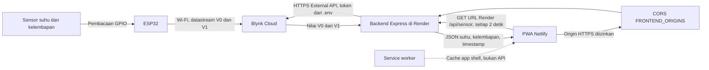

# Arsitektur Sistem Kebun

## Komponen

| Komponen | Tanggung jawab |
| --- | --- |
| Sensor dan ESP32 | Membaca suhu/kelembapan, terhubung ke Wi-Fi, lalu mengirim nilai ke datastream Blynk `V0` dan `V1`. |
| Blynk Cloud | Menyimpan nilai virtual pin dan menyediakan HTTPS External API untuk backend. |
| Backend Node.js/Express | Menyimpan token di `.env`, membaca `V0` dan `V1`, memvalidasi respons numerik, lalu menyediakan `GET /api/sensor`. |
| PWA di Netlify | Meminta data dari URL Render melalui `/api/sensor`, memperbarui indikator, waktu, kartu sensor, dan grafik. Tidak pernah menerima token Blynk. |
| CORS backend | Mengizinkan origin frontend yang dicantumkan pada `FRONTEND_ORIGINS`; menolak origin lain untuk API. |
| Service worker | Meng-cache app shell untuk pemuatan frontend saat offline. Endpoint `/api/` tidak di-cache agar pembacaan sensor tidak basi. |

## Diagram alur data



## Alur dan penanganan kegagalan

1. ESP32 membaca sensor dan mengirim nilainya melalui Wi-Fi ke Blynk.
2. Browser Netlify melakukan polling ke URL backend Render yang diatur di `config.js`. CORS menerima hanya origin yang didaftarkan pada `FRONTEND_ORIGINS`; service worker tidak meng-cache permintaan API.
3. Backend meminta `V0` dan `V1` ke Blynk dengan HTTPS, menggunakan token yang hanya tersedia di server.
4. Jika kedua nilai valid, backend mengirim JSON dan frontend memperbarui kartu sensor, indikator rentang, timestamp, dan grafik hingga 12 titik.
5. Jika Blynk gagal, timeout, backend tidak tersedia, atau respons tidak valid, backend/frontend melaporkan koneksi terputus. Dashboard mempertahankan pembacaan terakhir bila tersedia dan mencoba kembali setelah jeda polling.
6. Setelah app shell pernah di-cache, halaman dashboard tetap dapat dimuat saat offline. API sensor tidak tersedia hingga konektivitas pulih.

## Endpoint

### `GET /api/sensor`

Respons sukses (`200`):

```json
{
  "temperature": 25.4,
  "humidity": 68,
  "timestamp": "2026-01-01T10:00:00.000Z"
}
```

Kegagalan upstream Blynk mengembalikan HTTP `503` dengan pesan umum. Origin yang tidak diizinkan menerima HTTP `403`. Token tidak dimasukkan ke respons maupun bundle frontend.

## Deployment

- Render menjalankan `npm ci` lalu `npm start`; port diambil dari `process.env.PORT`.
- Set secret `BLYNK_AUTH_TOKEN` dan origin Netlify yang tepat pada `FRONTEND_ORIGINS` di environment Render.
- Netlify mempublikasikan root proyek. `config.js` mengatur base URL API Render dan tidak boleh berisi token.
- Lihat README untuk urutan setup, environment variables, dan verifikasi deployment.

## Tabel pengujian fungsional

| Pengujian | Cara / kondisi | Hasil yang diharapkan | Hasil |
| --- | --- | --- | --- |
| Sintaks JavaScript | `node --check` pada `app.js`, `server.js`, dan `sw.js` | Semua file lolos parsing | Lulus |
| Metadata PWA | Periksa properti manifest wajib dan aset ikon | Nama, short name, start URL, standalone, warna, dan ikon 192/512 tersedia | Lulus |
| App shell online | Buka halaman melalui server pada localhost | HTML, CSS, JS, manifest, dan ikon disajikan satu origin | Lulus; halaman dan aset merespons HTTP 200 |
| App shell offline | Muat halaman sekali, lalu simulasikan kegagalan jaringan untuk navigasi | `index.html` dari cache ditampilkan; API tidak di-cache | Lulus; diuji dengan simulasi service worker |
| Data dan grafik | Buka dashboard dengan datastream Blynk aktif | Suhu, kelembapan, waktu, indikator, dan grafik diperbarui | Lulus pada browser localhost dengan respons live; akurasi/perangkat fisik belum divalidasi |
| Blynk terputus | Putuskan permintaan API, lalu pulihkan | Dashboard menampilkan koneksi terputus, mempertahankan data terakhir, lalu pulih | Lulus untuk simulasi kegagalan browser; putus-sambung ESP32/Blynk fisik masih perlu diuji |
| Instalasi browser | Buka localhost di laptop atau origin HTTPS di perangkat | Browser menawarkan pemasangan PWA | Metadata, ikon, dan service worker lolos; pemasangan nyata masih perlu dikonfirmasi di Chrome/Edge dan perangkat HP |
| Kerahasiaan token | Cari pola token di aset frontend dan periksa respons API | Tidak ada token pada frontend atau respons | Lulus untuk pemeriksaan aset frontend |
| CORS Netlify | GET/OPTIONS dari origin yang terdaftar, lalu GET dari origin lain | Origin terdaftar menerima CORS; origin lain mendapat 403 | Lulus simulasi backend lokal; perlu konfirmasi ulang setelah deployment Render |

Pengujian sensor fisik membutuhkan ESP32 aktif, sensor terpasang, Wi-Fi, dan datastream Blynk yang benar. Pengujian file otomatis tidak membuktikan akurasi pengukuran sensor.
